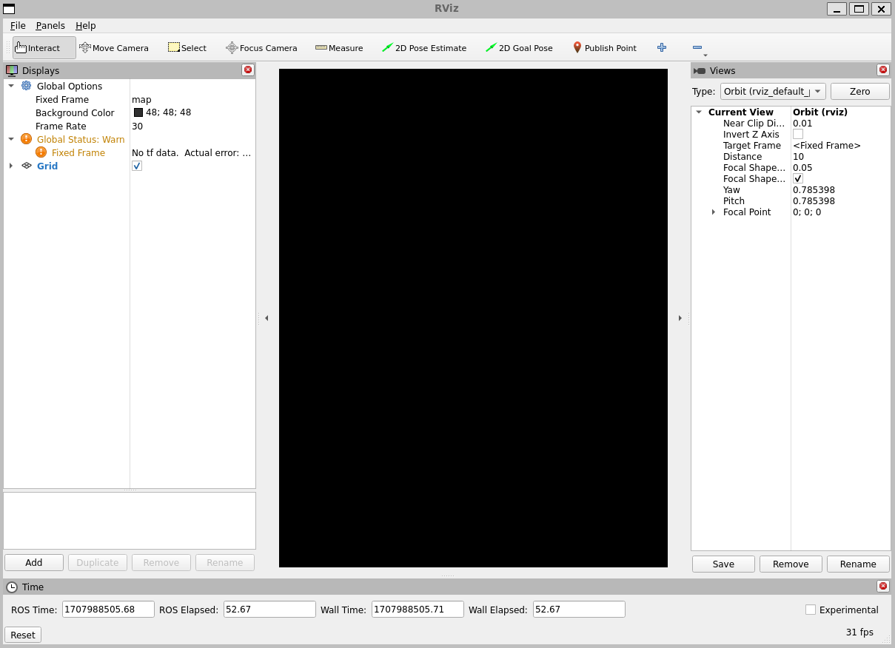
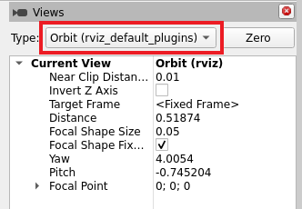
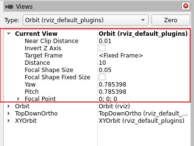

.. redirect-from::

    Tutorials/Intermediate/RViz/Marker-Sending-Basic-Shapes/Marker-Sending-Basic-Shapes

.. meta::
   :contentType: tutorial
   :experience: beginner
   :area: visualization, tools
   :distribution: {DISTRO}
   :product: {PRODUCT}

.. _LearningDataVisualization:

Learning about data visualization - tutorial
============================================

.. short-description::
   Markers let a ROS node display simple geometry in RViz without creating a custom display plugin.
   This article explains how to publish visualization_msgs/msg/Marker messages for basic shapes.
   After you follow it, you can show cubes, spheres, arrows, and cylinders in RViz.

.. showmeta::
   :order: area, contentType, experience
   :labels: area=Area, contentType=Content type, experience=Level

RViz is a 3D visualizer for ROS.
This article walks you through starting RViz, showing simple shapes from a marker publisher, and controlling the 3D view.
A hands-on exercise with sample marker shapes gives you practice viewing 3D data in RViz.

.. contents:: Contents
   :depth: 3
   :local:

Summary
-------

RViz renders 3D data from your ROS system, such as robot models, sensor readings, and primitive shapes.
A display is an RViz plugin that renders one kind of data in the 3D view.

The Marker display can show shapes that a node publishes as ``visualization_msgs/msg/Marker`` messages.
RViz does not need to know the meaning of marker data ahead of time.

This tutorial uses a small publisher that cycles through a cube, sphere, arrow, and cylinder.
Its markers give you sample data for setup, viewing, and camera control in RViz.

For more information, see :doc:`RViz User Guide <../RViz-User-Guide/RViz-User-Guide>`.

Prerequisites
-------------

#. :doc:`Install ROS <../../../../Get-Started/Installation>` and :doc:`set up your environment <../../../../Get-Started/Configuring-ROS2-Environment>`.
#. :doc:`Create a workspace <../../../../ROS-Framework/client-libraries/Working-with-Client-Libraries/Creating-A-Workspace/Creating-A-Workspace>`.
#. Familiarise yourself with the :doc:`RViz User Guide <../RViz-User-Guide/RViz-User-Guide>`.

Steps
-----

.. note::
   Source ROS in every new terminal you open.
   See :doc:`Configuring environment <../../../../Get-Started/Configuring-ROS2-Environment>`.
   After you build the tutorial package, also source your workspace overlay.

1 Get the marker publisher
^^^^^^^^^^^^^^^^^^^^^^^^^^

This tutorial uses the ``visualization_marker_tutorials`` package from the `visualization_tutorials repository <https://github.com/ros-visualization/visualization_tutorials>`__.
The ``basic_shapes`` executable publishes one marker at a time on ``/visualization_marker``.

Clone the repository into the ``src`` directory of your workspace, then build the ``visualization_marker_tutorials`` package.
The ``-b`` option selects the branch for this ROS distribution:

.. code-block:: console

   $ cd ~/ros2_ws/src
   $ git clone -b {REPOS_FILE_BRANCH} https://github.com/ros-visualization/visualization_tutorials.git
   $ cd ~/ros2_ws
   $ colcon build --packages-select visualization_marker_tutorials

If your workspace is not ``~/ros2_ws``, use your workspace path instead.

2 Start the marker publisher
^^^^^^^^^^^^^^^^^^^^^^^^^^^^

Open a new terminal, source your workspace overlay, and run ``basic_shapes``:

.. code-block:: console

   $ cd ~/ros2_ws
   $ source install/setup.bash
   $ ros2 run visualization_marker_tutorials basic_shapes

Leave this terminal running.
The node publishes a new shape about once a second, replacing the previous marker.

The source for that node is `basic_shapes.cpp <https://github.com/ros-visualization/visualization_tutorials/blob/{REPOS_FILE_BRANCH}/visualization_marker_tutorials/src/basic_shapes.cpp>`__.
You do not need to edit it for this tutorial.

3 Start RViz
^^^^^^^^^^^^

Open a new terminal and start RViz:

.. code-block:: console

   $ ros2 run rviz2 rviz2

You do not need the workspace overlay in this terminal.
``rviz2`` comes from your ROS installation.

When RViz starts for the first time, you should see a window like the following:

The large black area is the 3D view.
It is empty until a display has something to draw.

On the left is the **Displays** list.
It already contains **Global Options** and a **Grid**.
**Fixed Frame** defaults to ``map``.
**Global Status** may show a warning because the sample publisher does not publish transforms.
That is expected.

On the right is the **Views** panel.
If it is hidden, open it from the **Panels** menu.

4 Set the fixed frame
^^^^^^^^^^^^^^^^^^^^^

A physical robot operates within a three-dimensional world.
The fixed frame in RViz is the reference frame, the world in which the visualized robot operates.

In the **Displays** list, expand **Global Options** if needed, then set **Fixed Frame** to ``my_frame``.
Type the name without a leading slash.

The marker node publishes messages in the ``my_frame`` frame, and that name is the fixed frame.
It does not publish transforms, so RViz must use that same frame.

If **Fixed Frame** stays at ``map``, the marker will not show in the 3D view.

5 Add a Marker display
^^^^^^^^^^^^^^^^^^^^^^

The **Displays** list in RViz defines which different elements are included in the visualization. You need to subscribe to the marker messages to include them in the 3D view.

#. At the bottom of the **Displays** list, select **Add**:

   .. image:: ../RViz-User-Guide/images/add-button.png

   The **Create visualization** dialog opens on the **By display type** tab:

   .. image:: ../RViz-User-Guide/images/add-display-dialog.png

#. In the list, find ``rviz_default_plugins``.
   **Marker** is further down that group, after **TF** and **TwistStamped**.
   Scroll to **Marker**, select it, then select **OK**.

   You should now see a green marker at the origin that changes shape about once every second: cube, sphere, arrow, then cylinder.

   .. image:: images/basic_shapes_tutorial.png

   .. note::
      The Marker display status should be **OK**.
      **Global Status** can stay at **Warn** because nothing is publishing transforms.
      If the Marker status is a warning or error, expand the Marker entry and check the topic name and the fixed frame.

6 Change the view
^^^^^^^^^^^^^^^^^

The **Views** panel controls how RViz moves the camera and how it projects the 3D scene.
Each camera type combines a control scheme with a projection, either perspective or orthographic.

To see how the camera types differ, try the following:

* In the **Views** panel, check the **Type** list.
  The default camera type is **Orbit**.
  The camera rotates around a focal point and always looks at that point.
* In the **Type** list, select **FPS**.
  The camera now looks around from its own position.
* In the **Type** list, select **TopDownOrtho**.
  The camera looks down the fixed-frame Z axis.
  Objects do not get smaller with distance, because the projection is orthographic.

The **Save** button on the **Views** panel stores a named view, including the camera type, pose, and target frame.

7 Move the camera
^^^^^^^^^^^^^^^^^

Use the **Orbit** camera type to rotate, pan, and zoom around the marker in the 3D view.

#. In the **Views** panel, in the **Type** list, select **Orbit**.

#. On the toolbar, select the **Move Camera** tool.

   On first start, **Interact** may already be selected.

   The keyboard shortcut is :kbd:`m`.

   When **Move Camera** is selected, clicking in the 3D view moves the camera using the current view type.

   RViz shows the focal point as a small disc while you move the camera:

   .. image:: ../RViz-User-Guide/images/focal-point.png

#. In the 3D view, try the following:

   * **Left mouse button**: Click and drag to rotate around the focal point.
   * **Middle mouse button**, or :kbd:`Shift` and **left mouse button**: Click and drag to move the focal point.
   * **Right mouse button**: Click and drag to zoom.
     Drag up to zoom in, and down to zoom out.
   * **Scroll wheel**: Zoom in and out of the focal point.

   The status bar also summarizes these controls when **Move Camera** is selected.

   Rotate, pan, and zoom until you can see the changing marker clearly against the grid.

8 Clean up
^^^^^^^^^^

When you are done, stop ``basic_shapes`` and RViz so they do not keep running.
To stop ``basic_shapes`` and RViz, in each of their terminals, press :kbd:`Ctrl+C`.
You can also close the terminals instead.

Related content
---------------

More articles:

* :doc:`RViz User Guide <../RViz-User-Guide/RViz-User-Guide>`
* :doc:`Marker: Display types <../Marker-Display-types/Marker-Display-types>`
* :doc:`Marker: Points and Lines <../Marker-Points-and-Lines/Marker-Points-and-Lines>`
* :doc:`Learning about topics <../../../../ROS-Framework/interfaces/topics/Understanding-ROS2-Topics/Understanding-ROS2-Topics>`

FAQs
----

What is RViz?
   RViz is a 3D visualizer for ROS.
   It draws data from your system in a 3D view, using displays such as Grid, Marker, and RobotModel.

Why do I set the fixed frame to ``my_frame``?
   The sample publisher puts its markers in the ``my_frame`` frame.
   It does not publish transforms, so RViz must use that same frame as **Fixed Frame**.

Why is the 3D view black or empty?
   RViz has nothing to draw until you add a display that is receiving data.
   Start ``basic_shapes``, set **Fixed Frame** to ``my_frame``, and add a Marker display on ``/visualization_marker``.
   If **Fixed Frame** is still ``map``, the marker will not appear.

How do I rotate, pan, or zoom the 3D view?
   Select the **Move Camera** tool (shortcut :kbd:`m`).
   **Interact** may be selected when RViz starts.
   Keep the **Orbit** view, then, in the 3D view, use the mouse.
   Left-drag rotates, middle-drag or :kbd:`Shift`-left-drag moves the focal point, and right-drag or the scroll wheel zooms.
