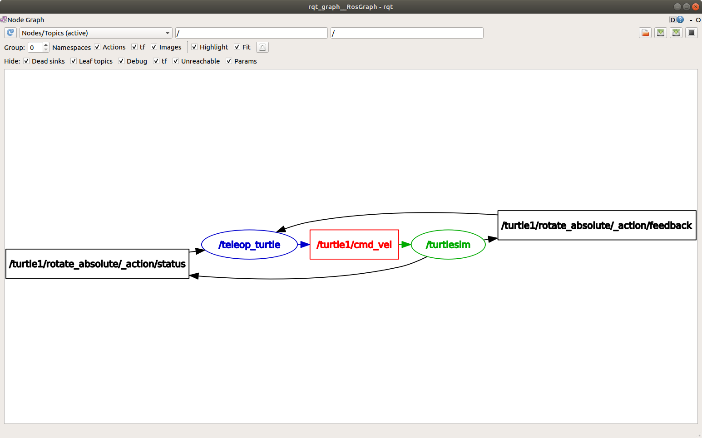

.. meta::
   :contentType: about
   :experience: beginner
   :area: framework
   :distribution: {DISTRO}
   :product: {PRODUCT}

How ROS works
=============

.. short-description::
   The ROS framework is the “plumbing” which allows for communication between parts of a robot, and within parts of a robot. 
   This article provides an overview of how the main components work together to enable this.

.. showmeta::
   :order: area, contentType, experience
   :labels: area=Area, contentType=Content type, experience=Level

.. toctree::
   :hidden:

.. contents:: Table of Contents
   :depth: 2
   :local:

Summary
-------
ROS systems use a network of modular software elements, called nodes, which process data concurrently and can communicate with each other through defined interfaces.
The ROS graph refers to the network of nodes.

Elements of a ROS system
------------------------

The ROS framework consists of multiple elements which allow you to build a complete robotics system that can receive data from sensors and transform that data into robotic actions.

A full robotic system is comprised of many nodes working together.
In ROS 2, a single executable (C++ program, Python program, etc.) can contain one or more nodes.
Each node in ROS should be responsible for a single, modular purpose, such as controlling a motor or publishing sensor data.
ROS nodes can process data concurrently and can communicate with each other.
See :doc:`About-Nodes`.

Communication between nodes is managed using the middleware interface. 
See :doc:`nodes/About-Discovery` and :doc:`client-libraries/About-Internal-Interfaces/About-Internal-Interfaces`.
Each node can send data to and receive data from other nodes.
See :doc:`Interfaces-Topics-Services-Actions`.

Parameters are used to configure nodes.
Parameters can be set at startup and can be modified during runtime if your code allows it.
See :doc:`About-Parameters`.

Client libraries are the APIs that allow you to implement your ROS code.
Client libraries implement code generators which allow you to interact with ROS interface files.
These interface files then allow nodes written with different client libraries to exchange messages. 
See :doc:`About-Client-Libraries`.

The ROS graph
-------------

The *ROS graph* describes the nodes in a system and their relationship to each other.

For example, in this simplified diagram, multiple nodes communicate with each other through different interfaces including a topic, a service, and an action.
Real systems often combine several of these patterns inside the same nodes.

.. mermaid::

   flowchart LR
      N1[Node A] -->|topic| N2[Node B]
      N1 -->|service| N3[Node C]
      N2 -->|action| N4[Node D]

The ROS graph can be visualized in multiple ways. 
For example, the visualized ROS graph using rqt in :doc:`interfaces/topics/Understanding-ROS2-Topics/Understanding-ROS2-Topics` shows two nodes, ``turtlesim`` and ``teleop_turtle``.
The ``/teleop_turtle`` node publishes data to the ``/turtle1/cmd_vel`` topic, and the ``/turtlesim`` node is subscribed to that topic to receive the data.

ROS CLI and client libraries
----------------------------

You can build with ROS using the command line and the ROS API.

* ROS CLI:
   The ROS command line tools allow you to interact with your ROS system using the command line interface (CLI).
   You can use the CLI for a variety of tasks including launching or investigating nodes.
* ROS API:
   The ROS API allows you to build and run complex systems using client libraries.
   For a more in-depth description of the ROS API, see :doc:`client-libraries/About-Internal-Interfaces/About-Internal-Interfaces`.

.. note::
   If you are new to ROS, working with the CLI will help you understand ROS elements and how to interact with them.
   ROS command line tools allow you to explore a live graph before writing your own nodes, and client libraries let you implement the same concepts in code.
   See :doc:`../First-Steps`.

Related content
---------------
* :doc:`nodes/About-Discovery`
* :doc:`About-Client-Libraries`
* :doc:`About-Parameters`
* :doc:`Interfaces-Topics-Services-Actions`
* :doc:`nodes/Working-with-nodes`   

FAQs
----

What is a node in ROS?
   A node is a modular software component within a ROS system that is responsible for a specific task, such as controlling a motor or publishing sensor data.

   A single executable can contain one or more nodes, and nodes communicate with each other through defined ROS interfaces.

How do ROS nodes communicate with each other?
   ROS nodes exchange data through topics, services, and actions.
   Communication between nodes is handled by the underlying middleware, which also supports discovery across the ROS graph.
   Parameters configure individual nodes; they are not a communication interface.

Why should I learn the ROS CLI before creating my own nodes?
   The ROS CLI helps you explore and understand a live ROS graph before writing code.

   Using the command line tools allows you to inspect nodes, topics, services, and other ROS elements, making it easier to understand how components interact before using the ROS API to create your own applications.

What is the ROS graph?
   The ROS graph is the network of nodes in a ROS system and the relationships between them.

   It represents how nodes communicate through topics, services, and actions, and can be visualised using ROS tools such as ``rqt_graph``.