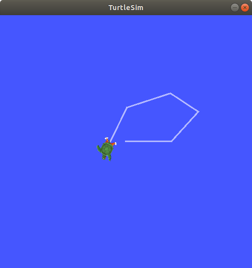
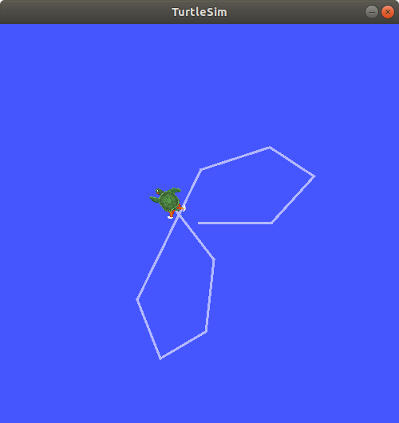

.. redirect-from::

    Tutorials/Ros2bag/Recording-And-Playing-Back-Data
    Tutorials/Beginner-CLI-Tools/Recording-And-Playing-Back-Data/Recording-And-Playing-Back-Data

.. meta::
   :contentType: tutorial
   :experience: beginner
   :area: interfaces, framework
   :distribution: {DISTRO}
   :product: {PRODUCT}

.. _ROS2Bag:

Recording and playing back data - tutorial
==========================================

.. short-description::
   ``ros2 bag`` records data from topics, services, and actions so you can save and replay it later.
   This tutorial shows you how to record, inspect, and play back that data with the ``ros2 bag`` command-line tools.
   After completing it, you can create bag files, examine their contents, and replay them for debugging or analysis.

.. showmeta::
   :order: area, contentType, experience
   :labels: area=Area, contentType=Content type, experience=Level

.. contents:: Contents
   :depth: 3
   :local:

Summary
-------

Use ``ros2 bag record`` to save data from topics, services, and actions, ``ros2 bag info`` to inspect a recording, and ``ros2 bag play`` to replay it.
Recordings are stored in bag directories as ``.mcap`` files that you can share or reuse to reproduce experiments.

Prerequisites
-------------

#. :doc:`Install ROS <../../../../Get-Started/Installation>`.
#. If you are not already familiar with topics, complete the :doc:`Learning about topics <../../topics/Understanding-ROS2-Topics/Understanding-ROS2-Topics>` tutorial.
#. This article uses several packages which are included in a typical desktop installation. If you have a custom installation, ensure you have the following:

   * ``turtlesim``
   * ``demo_nodes_cpp``
   * ``action_tutorials_py``
   * ``action_tutorials_cpp``

Steps
-----

.. note::
   Source ROS in every new terminal you open.
   See :doc:`Configuring environment <../../../../Get-Started/Configuring-ROS2-Environment>`.

1 Record, inspect, and play back topics
^^^^^^^^^^^^^^^^^^^^^^^^^^^^^^^^^^^^^^^

1 Run the Turtlesim nodes
~~~~~~~~~~~~~~~~~~~~~~~~~

The topic examples use the ``turtlesim`` package.
Run the ``/turtlesim`` and ``/teleop_turtle`` nodes before recording keyboard input.

Open a new terminal and run:

.. code-block:: console

    $ ros2 run turtlesim turtlesim_node

Open another terminal and run:

.. code-block:: console

    $ ros2 run turtlesim turtle_teleop_key

Create a directory to store recordings:

.. tabs::

    .. group-tab:: Linux

        .. code-block:: console

            $ mkdir bag_files
            $ cd bag_files

    .. group-tab:: macOS

        .. code-block:: console

            $ mkdir bag_files
            $ cd bag_files

    .. group-tab:: Windows

        .. code-block:: console

            $ md bag_files
            $ cd bag_files

2 Choose a topic to record
~~~~~~~~~~~~~~~~~~~~~~~~~~

``ros2 bag`` can record data from messages published to topics.

To list active topics, open a new terminal and run:

.. code-block:: console

  $ ros2 topic list

The terminal returns:

.. code-block:: console

  /parameter_events
  /rosout
  /turtle1/cmd_vel
  /turtle1/color_sensor
  /turtle1/pose

As shown in :doc:`Understanding topics <../../topics/Understanding-ROS2-Topics/Understanding-ROS2-Topics>`, the ``/teleop_turtle`` node publishes commands on the ``/turtle1/cmd_vel`` topic to move the turtle in Turtlesim.

To see the data that ``/turtle1/cmd_vel`` is publishing, run:

.. code-block:: console

    $ ros2 topic echo /turtle1/cmd_vel

Nothing appears at first because the teleoperation node is not publishing yet.
Return to the terminal where you ran the teleoperation node and select it so it is active.
Use the arrow keys to move the turtle around.

In the terminal running ``ros2 topic echo``, data appears:

.. code-block:: console

  linear:
    x: 2.0
    y: 0.0
    z: 0.0
  angular:
    x: 0.0
    y: 0.0
    z: 0.0
    ---

3 Record topics
~~~~~~~~~~~~~~~

Use ``ros2 bag record`` to save topic data into a bag directory.
You can record one topic, several topics at once, or split a long recording across multiple files.

3.1 Record a single topic
"""""""""""""""""""""""""

Open a new terminal and move into the ``bag_files`` directory you created earlier.
``ros2 bag record`` creates the bag directory in the working directory where you run the command.

To record data published to a topic, use the following syntax:

.. code-block:: console

    $ ros2 bag record --topics <topic_name>

For example, record ``/turtle1/cmd_vel``:

.. code-block:: console

    $ ros2 bag record --topics /turtle1/cmd_vel

You should see output similar to:

.. code-block:: console

    [INFO] [rosbag2_storage]: Opened database 'rosbag2_2019_10_11-05_18_45'.
    [INFO] [rosbag2_transport]: Listening for topics...
    [INFO] [rosbag2_transport]: Subscribed to topic '/turtle1/cmd_vel'
    [INFO] [rosbag2_transport]: All requested topics are subscribed. Stopping discovery...

Now ``ros2 bag`` is recording the data published on the ``/turtle1/cmd_vel`` topic.
Return to the teleoperation terminal and move the turtle around again.
The exact path does not matter, but try to make a recognisable pattern to verify playback later.

Press :kbd:`Ctrl-C` to stop recording.

The data will be accumulated in a new bag directory with a name in the pattern of ``rosbag2_year_month_day-hour_minute_second``.
This directory will contain a ``metadata.yaml`` along with the bag file in the recorded format.

3.2 Record multiple topics
""""""""""""""""""""""""""

You can also record multiple topics, as well as change the name of the bag directory to which ``ros2 bag`` saves the recording.

Run the following command:

.. code-block:: console

  $ ros2 bag record -o subset --topics /turtle1/cmd_vel /turtle1/pose

You should see output similar to:

.. code-block:: console

  [INFO] [rosbag2_storage]: Opened database 'subset'.
  [INFO] [rosbag2_transport]: Listening for topics...
  [INFO] [rosbag2_transport]: Subscribed to topic '/turtle1/cmd_vel'
  [INFO] [rosbag2_transport]: Subscribed to topic '/turtle1/pose'
  [INFO] [rosbag2_transport]: All requested topics are subscribed. Stopping discovery...

The ``-o`` option sets the bag directory name.
In this example, the directory is named ``subset``.

To record more than one topic at a time, simply list each topic separated by a space after ``--topics``.
In this case, the command output above confirms that both topics are being recorded.

You can move the turtle around and press :kbd:`Ctrl-C` when you're finished.

.. note::

    There is another option you can add to the command, ``-a`` / ``--all``, which records all topics, services, and actions.
    To record only topics, use ``--all-topics``.

3.3 Split recording into multiple files
"""""""""""""""""""""""""""""""""""""""

You can split your recording into multiple files, based on either recording duration or file size.
``-d <max_bag_duration>`` ensures that each file only lasts ``<max_bag_duration>`` seconds before it starts writing to a new file.
``-b <max_bag_size>`` ensures that each file does not exceed ``<max_bag_size>`` bytes in file size.
Splitting the recording keeps individual files smaller and limits how much data you lose if a recording becomes corrupted.

Run this command and keep it recording for at least 15 seconds so that three 5-second bag files are written:

.. code-block:: console

    $ ros2 bag record -o subset_split -d 5 --topics /turtle1/cmd_vel /turtle1/pose

You should see output similar to:

.. code-block:: console

    [INFO] [rosbag2_recorder]: Press SPACE for pausing/resuming
    [INFO] [rosbag2_recorder]: Listening for topics...
    [INFO] [rosbag2_recorder]: Event publisher thread: Starting
    [INFO] [rosbag2_recorder]: Recording...
    [INFO] [rosbag2_recorder]: Subscribed to topic '/turtle1/cmd_vel'
    [INFO] [rosbag2_recorder]: Subscribed to topic '/turtle1/pose'
    [INFO] [rosbag2_recorder]: All requested topics are subscribed. Stopping discovery...
    [INFO] [rosbag2_cpp]: Writing remaining messages from cache to the bag. It may take a while
    [INFO] [rosbag2_cpp]: Writing remaining messages from cache to the bag. It may take a while
    [INFO] [rosbag2_cpp]: Writing remaining messages from cache to the bag. It may take a while

Press :kbd:`Ctrl-C` when you are finished.
You should find a ``subset_split`` directory containing numbered files such as ``0_subset_split_YYYY_MM_DD-HH_MM_SS.mcap`` and ``1_subset_split_YYYY_MM_DD-HH_MM_SS.mcap``.

.. note::

   Split file naming changed in Lyrical.
   On earlier distributions, the files may instead look like ``subset_split_0.mcap``, ``subset_split_1.mcap``, and so on.

4 Inspect a topic recording
~~~~~~~~~~~~~~~~~~~~~~~~~~~

To see details about a recording, run:

.. code-block:: console

    $ ros2 bag info <bag_name>

Running this command on the ``subset`` bag recording returns information similar to:

.. code-block:: console

    $ ros2 bag info subset

The terminal returns:

.. code-block:: console

    Files:             subset_0.mcap
    Bag size:          228.5 KiB
    Storage id:        mcap
    ROS Distro:        rolling
    Duration:          48.47s
    Start:             Oct 11 2019 06:09:09.12 (1570799349.12)
    End                Oct 11 2019 06:09:57.60 (1570799397.60)
    Messages:          3013
    Topic information: Topic: /turtle1/cmd_vel | Type: geometry_msgs/msg/Twist | Count: 9 | Serialization Format: cdr
                       Topic: /turtle1/pose | Type: turtlesim_msgs/msg/Pose | Count: 3004 | Serialization Format: cdr
    Services:          0
    Service information:
    Actions:           0
    Action information:

You can also run ``ros2 bag info`` on an individual file, such as ``subset_split/0_subset_split_YYYY_MM_DD-HH_MM_SS.mcap``.
That shows information for only that portion of the recording.
In this example, that is the first 5 seconds.

5 Play back topic data
~~~~~~~~~~~~~~~~~~~~~~

Use ``ros2 bag play`` to replay a recorded bag, or several bags together with synced timing.

5.1 Play a single bag
"""""""""""""""""""""

Before replaying the bag, enter :kbd:`Ctrl-C` in the terminal where the teleoperation node is running.
Make sure the Turtlesim window is visible so that you can see playback.

Run:

.. code-block:: console

    $ ros2 bag play subset

You should see output similar to:

.. code-block:: console

    [INFO] [rosbag2_player]: Set rate to 1
    [INFO] [rosbag2_player]: Adding keyboard callbacks.
    [INFO] [rosbag2_player]: Press SPACE for Pause/Resume
    [INFO] [rosbag2_player]: Press CURSOR_RIGHT for Play Next Message
    [INFO] [rosbag2_player]: Press CURSOR_UP for Increase Rate 10%
    [INFO] [rosbag2_player]: Press CURSOR_DOWN for Decrease Rate 10%
    Progress bar enabled at 3 Hz.
    Progress bar [?]: [R]unning, [P]aused, [B]urst, [D]elayed, [S]topped
    [INFO] [rosbag2_player]: Playback until timestamp: -1

    ====== Playback Progress ======
    [1751923361.427372456] Duration 0.00/48.47 [R]

The turtle follows approximately the same path entered during recording.
Turtlesim is sensitive to small changes in system timing, so playback may not match exactly.

Because the ``subset`` file recorded the ``/turtle1/pose`` topic, ``ros2 bag play`` does not exit until playback finishes, even if the turtle was not moving during recording.

While the ``/turtlesim`` node is active, it publishes data on the ``/turtle1/pose`` topic at regular intervals.
In the ``ros2 bag info`` example above, the ``/turtle1/cmd_vel`` topic ``Count`` is 9, matching the number of arrow-key presses during recording.

The ``/turtle1/pose`` topic ``Count`` is over 3000 because data was published on that topic throughout the recording.

To see how often position data is published, run:

.. code-block:: console

    $ ros2 topic hz /turtle1/pose

5.2 Play multiple bags in parallel
""""""""""""""""""""""""""""""""""

You can split recorded topics across separate bags to distribute the recording workload.
For example, record ``/turtle1/cmd_vel`` and ``/turtle1/pose`` in separate terminals.

In the first terminal, run:

.. code-block:: console

    $ ros2 bag record -o subset_cmd_vel --topics /turtle1/cmd_vel

In the second terminal, run:

.. code-block:: console

    $ ros2 bag record -o subset_pose --topics /turtle1/pose

Move the turtle around, then stop both recordings with :kbd:`Ctrl-C`.

To play these recordings together with correct timing, pass ``-i <bag_name>`` for each bag:

.. code-block:: console

    $ ros2 bag play -i subset_cmd_vel -i subset_pose

This plays the ``subset_cmd_vel`` and ``subset_pose`` recordings together, with playback synced to replicate the original message order.
The optional argument ``--message-order {received,sent}`` sets whether messages are sequenced by receive time or publish time.
The default is ``received``.
This option also applies when playing a single bag.

2 Record, inspect, and play back services
^^^^^^^^^^^^^^^^^^^^^^^^^^^^^^^^^^^^^^^^^

.. note::

   Recording and playing back services requires Jazzy or a later distribution.

1 Run the introspection demo nodes
~~~~~~~~~~~~~~~~~~~~~~~~~~~~~~~~~~

The service examples use the :doc:`Service Introspection Demo <../../../../Developer-Tools/Introspection-and-analysis/Service-Introspection>`.
Service introspection must be enabled on both the client and server nodes to record service data.

Open a new terminal and run ``introspection_service`` with service introspection enabled:

.. code-block:: console

    $ ros2 run demo_nodes_cpp introspection_service --ros-args -p service_configure_introspection:=contents

Open another terminal and run ``introspection_client`` with service introspection enabled:

.. code-block:: console

    $ ros2 run demo_nodes_cpp introspection_client --ros-args -p client_configure_introspection:=contents

2 Check that services are available
~~~~~~~~~~~~~~~~~~~~~~~~~~~~~~~~~~~

``ros2 bag`` can only record data from available services.
To list active services, open a new terminal and run:

.. code-block:: console

  $ ros2 service list

The terminal returns:

.. code-block:: console

  /add_two_ints
  /introspection_client/describe_parameters
  /introspection_client/get_parameter_types
  /introspection_client/get_parameters
  /introspection_client/get_type_description
  /introspection_client/list_parameters
  /introspection_client/set_parameters
  /introspection_client/set_parameters_atomically
  /introspection_service/describe_parameters
  /introspection_service/get_parameter_types
  /introspection_service/get_parameters
  /introspection_service/get_type_description
  /introspection_service/list_parameters
  /introspection_service/set_parameters
  /introspection_service/set_parameters_atomically

To verify that service introspection is enabled, run:

.. code-block:: console

  $ ros2 service echo --flow-style /add_two_ints

You should see output similar to:

.. code-block:: console

  info:
    event_type: REQUEST_SENT
    stamp:
      sec: 1713995389
      nanosec: 386809259
    client_gid: [1, 15, 96, 219, 162, 1, 108, 201, 0, 0, 0, 0, 0, 0, 21, 3]
    sequence_number: 133
  request: [{a: 2, b: 3}]
  response: []
  ---

You should see the service communication.

3 Record services
~~~~~~~~~~~~~~~~~

Use ``--services`` to record named services, or ``--all-services`` to record every available service.
You can record services and topics at the same time.

To record specific services:

.. code-block:: console

  $ ros2 bag record --services <service_names>

To record all services:

.. code-block:: console

  $ ros2 bag record --all-services

Run the command:

.. code-block:: console

  $ ros2 bag record --services /add_two_ints

You should see output similar to:

.. code-block:: console

  [INFO] [1713995957.643573503] [rosbag2_recorder]: Press SPACE for pausing/resuming
  [INFO] [1713995957.662067587] [rosbag2_recorder]: Event publisher thread: Starting
  [INFO] [1713995957.662067614] [rosbag2_recorder]: Listening for topics...
  [INFO] [1713995957.666048323] [rosbag2_recorder]: Subscribed to topic '/add_two_ints/_service_event'
  [INFO] [1713995957.666092458] [rosbag2_recorder]: Recording...

Now ``ros2 bag`` is recording the service data published on the ``/add_two_ints`` service.
To stop the recording, enter :kbd:`Ctrl-C` in the terminal.

The data will be accumulated in a new bag directory with a name in the pattern of ``rosbag2_year_month_day-hour_minute_second``.
This directory will contain a ``metadata.yaml`` along with the bag file in the recorded format.

4 Inspect a service recording
~~~~~~~~~~~~~~~~~~~~~~~~~~~~~

To see details about a recording, run:

.. code-block:: console

  $ ros2 bag info <bag_file_name>

You should see output similar to:

.. code-block:: console

  Files:             rosbag2_2024_04_24-14_59_17_0.mcap
  Bag size:          15.1 KiB
  Storage id:        mcap
  ROS Distro:        rolling
  Duration:          9.211s
  Start:             Apr 24 2024 14:59:17.676 (1713995957.676)
  End:               Apr 24 2024 14:59:26.888 (1713995966.888)
  Messages:          0
  Topic information:
  Service:           1
  Service information: Service: /add_two_ints | Type: example_interfaces/srv/AddTwoInts | Event Count: 78 | Serialization Format: cdr

5 Play back service data
~~~~~~~~~~~~~~~~~~~~~~~~

Before replaying the bag file, enter :kbd:`Ctrl-C` in the terminal where ``introspection_client`` is running.
When ``introspection_client`` stops, ``introspection_service`` also stops printing results because there are no incoming requests.

Playback sends service requests from the bag file to ``introspection_service``.

Run:

.. code-block:: console

  $ ros2 bag play --publish-service-requests <bag_file_name>

You should see output similar to:

.. code-block:: console

  [INFO] [1713997477.870856190] [rosbag2_player]: Set rate to 1
  [INFO] [1713997477.877417477] [rosbag2_player]: Adding keyboard callbacks.
  [INFO] [1713997477.877442404] [rosbag2_player]: Press SPACE for Pause/Resume
  [INFO] [1713997477.877447855] [rosbag2_player]: Press CURSOR_RIGHT for Play Next Message
  [INFO] [1713997477.877452655] [rosbag2_player]: Press CURSOR_UP for Increase Rate 10%
  [INFO] [1713997477.877456954] [rosbag2_player]: Press CURSOR_DOWN for Decrease Rate 10%
  [INFO] [1713997477.877573647] [rosbag2_player]: Playback until timestamp: -1

The ``introspection_service`` terminal starts printing service messages again:

.. code-block:: console

  [INFO] [1713997478.090466075] [introspection_service]: Incoming request
  a: 2 b: 3

``ros2 bag play`` sends the service request data from the bag file to the ``/add_two_ints`` service.

To inspect service communication during playback, run this command before ``ros2 bag play``:

.. code-block:: console

  $ ros2 service echo --flow-style /add_two_ints

The output shows the service request from the bag file and the response from ``introspection_service``.

.. code-block:: console

  info:
    event_type: REQUEST_RECEIVED
    stamp:
      sec: 1713998176
      nanosec: 372700698
    client_gid: [1, 15, 96, 219, 80, 2, 158, 123, 0, 0, 0, 0, 0, 0, 20, 4]
    sequence_number: 1
  request: [{a: 2, b: 3}]
  response: []
  ---
  info:
    event_type: RESPONSE_SENT
    stamp:
      sec: 1713998176
      nanosec: 373016882
    client_gid: [1, 15, 96, 219, 80, 2, 158, 123, 0, 0, 0, 0, 0, 0, 20, 4]
    sequence_number: 1
  request: []
  response: [{sum: 5}]

.. _record-play-data-action:

3 Record, inspect, and play back actions
^^^^^^^^^^^^^^^^^^^^^^^^^^^^^^^^^^^^^^^^

.. note::

   Recording and playing back actions requires Kilted or a later distribution.

1 Run the fibonacci action server
~~~~~~~~~~~~~~~~~~~~~~~~~~~~~~~~~

The action examples use the :doc:`Action Introspection Demo <../../actions/Working-with-actions/Action-Introspection>`.
Action introspection must be enabled on the server and client to record action data.

Open a new terminal and run ``fibonacci_action_server`` with action introspection enabled:

.. code-block:: console

  $ ros2 run action_tutorials_py fibonacci_action_server --ros-args -p action_server_configure_introspection:=contents

``ros2 bag`` can only record data from available actions.
With the server running, open a new terminal and list active actions:

.. code-block:: console

  $ ros2 action list

The terminal returns:

.. code-block:: console

  /fibonacci

2 Record actions
~~~~~~~~~~~~~~~~

Use ``--actions`` to record named actions, or ``--all-actions`` to record every available action.
You can record actions together with topics and services.

The ``fibonacci_action_client`` sends one goal and then exits.
Start recording before you run the client so the goal, feedback, and result are captured.

To record specific actions:

.. code-block:: console

  $ ros2 bag record --actions <action_names>

To record all actions:

.. code-block:: console

  $ ros2 bag record --all-actions

In a new terminal, start recording ``/fibonacci``:

.. code-block:: console

  $ ros2 bag record --actions /fibonacci

You should see output similar to:

.. code-block:: console

  [INFO] [1744953225.214114862] [rosbag2_recorder]: Press SPACE for pausing/resuming
  [INFO] [1744953225.218369761] [rosbag2_recorder]: Listening for topics...
  [INFO] [1744953225.218386223] [rosbag2_recorder]: Event publisher thread: Starting
  [INFO] [1744953225.218580294] [rosbag2_recorder]: Recording...
  [INFO] [1744953225.725417634] [rosbag2_recorder]: Subscribed to topic '/fibonacci/_action/cancel_goal/_service_event'
  [INFO] [1744953225.727901848] [rosbag2_recorder]: Subscribed to topic '/fibonacci/_action/feedback'
  [INFO] [1744953225.729655213] [rosbag2_recorder]: Subscribed to topic '/fibonacci/_action/get_result/_service_event'
  [INFO] [1744953225.731315612] [rosbag2_recorder]: Subscribed to topic '/fibonacci/_action/send_goal/_service_event'
  [INFO] [1744953225.735061252] [rosbag2_recorder]: Subscribed to topic '/fibonacci/_action/status'
  ...

While recording is active, open another terminal and run the action client with introspection enabled:

.. code-block:: console

  $ ros2 run action_tutorials_cpp fibonacci_action_client --ros-args -p action_client_configure_introspection:=contents

The client sends a goal, receives feedback, then exits.
To capture more action traffic, run the client again while recording is still active.

In another terminal, verify introspection while the client runs:

.. code-block:: console

  $ ros2 action echo --flow-style /fibonacci

You should see output similar to:

.. code-block:: console

  interface: GOAL_SERVICE
  info:
    event_type: REQUEST_SENT
    stamp:
      sec: 1744917904
      nanosec: 760683446
    client_gid: [1, 15, 165, 231, 234, 109, 65, 202, 0, 0, 0, 0, 0, 0, 19, 4]
    sequence_number: 1
  request: [{goal_id: {uuid: [81, 55, 121, 145, 81, 66, 209, 93, 214, 113, 255, 100, 120, 6, 102, 83]}, goal: {order: 10}}]
  response: []
  ---
  ...

When you have finished recording, enter :kbd:`Ctrl-C` in the ``ros2 bag record`` terminal.

The data is stored in a new bag directory with a name in the pattern of ``rosbag2_year_month_day-hour_minute_second``.
This directory contains a ``metadata.yaml`` file along with the bag file in the recorded format.

3 Inspect an action recording
~~~~~~~~~~~~~~~~~~~~~~~~~~~~~

To see details about a recording, run:

.. code-block:: console

  $ ros2 bag info <bag_file_name>

You should see output similar to:

.. code-block:: console

  Files:             rosbag2_2025_04_17-22_20_40_0.mcap
  Bag size:          20.7 KiB
  Storage id:        mcap
  ROS Distro:        rolling
  Duration:          9.019568080s
  Start:             Apr 17 2025 22:20:47.263125070 (1744953647.263125070)
  End:               Apr 17 2025 22:20:56.282693150 (1744953656.282693150)
  Messages:          0
  Topic information:
  Services:          0
  Service information:
  Actions:           1
  Action information:
    Action: /fibonacci | Type: example_interfaces/action/Fibonacci | Topics: 2 | Service: 3 | Serialization Format: cdr
      Topic: feedback | Count: 9
      Topic: status | Count: 3
      Service: send_goal | Event Count: 4
      Service: cancel_goal | Event Count: 0
      Service: get_result | Event Count: 4

4 Play back action data
~~~~~~~~~~~~~~~~~~~~~~~

Keep ``fibonacci_action_server`` running.
Playback sends action goal requests from the bag file to that server.

In another terminal, start introspection before playback:

.. code-block:: console

  $ ros2 action echo --flow-style /fibonacci

Then run:

.. code-block:: console

  $ ros2 bag play --send-actions-as-client <bag_file_name>

You should see output similar to:

.. code-block:: console

  [INFO] [1744953720.691068674] [rosbag2_player]: Set rate to 1
  [INFO] [1744953720.702365209] [rosbag2_player]: Adding keyboard callbacks.
  [INFO] [1744953720.702409447] [rosbag2_player]: Press SPACE for Pause/Resume
  [INFO] [1744953720.702423063] [rosbag2_player]: Press CURSOR_RIGHT for Play Next Message
  [INFO] [1744953720.702431404] [rosbag2_player]: Press CURSOR_UP for Increase Rate 10%
  [INFO] [1744953720.702437677] [rosbag2_player]: Press CURSOR_DOWN for Decrease Rate 10%
  Progress bar enabled at 3 Hz.
  Progress bar [?]: [R]unning, [P]aused, [B]urst, [D]elayed, [S]topped
  [INFO] [1744953720.702577680] [rosbag2_player]: Playback until timestamp: -1

  ====== Playback Progress ======
  [1744953656.281683207] Duration 9.02/9.02 [R]

The ``fibonacci_action_server`` terminal starts printing feedback messages again:

.. code-block:: console

  [INFO] [1744953720.815577088] [fibonacci_action_server]: Executing goal...
  [INFO] [1744953720.815927050] [fibonacci_action_server]: Feedback: array('i', [0, 1, 1])
  [INFO] [1744953721.816509658] [fibonacci_action_server]: Feedback: array('i', [0, 1, 1, 2])
  [INFO] [1744953722.817220270] [fibonacci_action_server]: Feedback: array('i', [0, 1, 1, 2, 3])
  [INFO] [1744953723.817876426] [fibonacci_action_server]: Feedback: array('i', [0, 1, 1, 2, 3, 5])
  [INFO] [1744953724.818498515] [fibonacci_action_server]: Feedback: array('i', [0, 1, 1, 2, 3, 5, 8])
  [INFO] [1744953725.819182228] [fibonacci_action_server]: Feedback: array('i', [0, 1, 1, 2, 3, 5, 8, 13])
  [INFO] [1744953726.820032562] [fibonacci_action_server]: Feedback: array('i', [0, 1, 1, 2, 3, 5, 8, 13, 21])
  [INFO] [1744953727.820738690] [fibonacci_action_server]: Feedback: array('i', [0, 1, 1, 2, 3, 5, 8, 13, 21, 34])
  [INFO] [1744953728.821449308] [fibonacci_action_server]: Feedback: array('i', [0, 1, 1, 2, 3, 5, 8, 13, 21, 34, 55])

``ros2 bag play`` sends the action goal request data from the bag file to the ``/fibonacci`` action.

If you started ``ros2 action echo`` before playback, the output shows the action goal request from the bag file and responses from ``fibonacci_action_server``:

.. code-block:: console

  interface: STATUS_TOPIC
  status_list: [{goal_info: {goal_id: {uuid: [34, 116, 225, 217, 48, 121, 146, 36, 240, 98, 99, 134, 55, 227, 184, 72]}, stamp: {sec: 1744953720, nanosec: 804984321}}, status: 4}]
  ---
  interface: GOAL_SERVICE
  info:
    event_type: REQUEST_RECEIVED
    stamp:
      sec: 1744953927
      nanosec: 957359210
    client_gid: [1, 15, 165, 231, 190, 254, 1, 50, 0, 0, 0, 0, 0, 0, 19, 4]
    sequence_number: 1
  request: [{goal_id: {uuid: [191, 200, 153, 122, 221, 251, 152, 172, 60, 69, 94, 20, 212, 160, 40, 12]}, goal: {order: 10}}]
  response: []
  ---
  interface: GOAL_SERVICE
  info:
    event_type: RESPONSE_SENT
    stamp:
      sec: 1744953927
      nanosec: 957726145
    client_gid: [1, 15, 165, 231, 190, 254, 1, 50, 0, 0, 0, 0, 0, 0, 19, 4]
    sequence_number: 1
  request: []
  response: [{accepted: true, stamp: {sec: 1744953927, nanosec: 957615866}}]
  ---
  interface: STATUS_TOPIC
  status_list: [{goal_info: {goal_id: {uuid: [191, 200, 153, 122, 221, 251, 152, 172, 60, 69, 94, 20, 212, 160, 40, 12]}, stamp: {sec: 1744953927, nanosec: 957663383}}, status: 2}]
  ---
  interface: FEEDBACK_TOPIC
  goal_id:
    uuid: [191, 200, 153, 122, 221, 251, 152, 172, 60, 69, 94, 20, 212, 160, 40, 12]
  feedback:
    sequence: [0, 1, 1]
  ---
  ...

Related content
---------------

More articles:

* :doc:`Learning about nodes <../../../nodes/Working-with-nodes/Understanding-ROS2-Nodes/Understanding-ROS2-Nodes>`
* :doc:`Understanding topics <../../topics/Understanding-ROS2-Topics/Understanding-ROS2-Topics>`
* :doc:`Understanding services <../../services/Working-with-services/Understanding-ROS2-Services/Understanding-ROS2-Services>`
* :doc:`Understanding actions <../../actions/Working-with-actions/Understanding-ROS2-Actions/Understanding-ROS2-Actions>`
* :doc:`Overriding QoS policies for recording and playback <../../../../Developer-Tools/Debugging/Testing/Overriding-QoS-Policies-For-Recording-And-Playback>`

External resources:

* `rosbag2 README <https://github.com/ros2/rosbag2>`__: thorough explanation of ``ros2 bag``.
* `Service recording and playback design <https://github.com/ros2/rosbag2/blob/{DISTRO}/docs/design/rosbag2_record_replay_service.md>`__: design details for services.
* `Action recording and playback design <https://github.com/ros2/rosbag2/blob/{DISTRO}/docs/design/rosbag2_record_replay_action.md>`__: design details for actions.

FAQs
----

What does ``ros2 bag`` record?
   It can record data from topics, services, and actions in your ROS system.
   You choose which interfaces to record with options such as ``--topics``, ``--services``, and ``--actions``.

Where are recordings saved?
   In a bag directory created in the working directory where you run ``ros2 bag record``.
   Use ``-o`` to set a custom directory name.
   Each bag directory contains metadata and the recorded data files.

How do I inspect a recording before playing it back?
   Run ``ros2 bag info <bag_name>``.
   The output lists duration, message counts, and which topics, services, and actions were recorded.

How do I play back service or action data?
   For services, use ``ros2 bag play --publish-service-requests <bag_file_name>``.
   For actions, use ``ros2 bag play --send-actions-as-client <bag_file_name>``.
   Topic playback uses ``ros2 bag play <bag_name>``.
